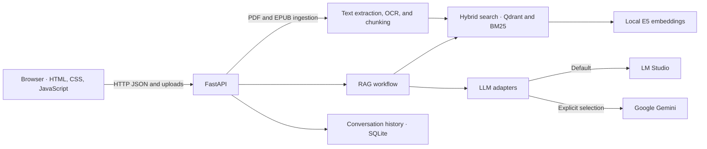
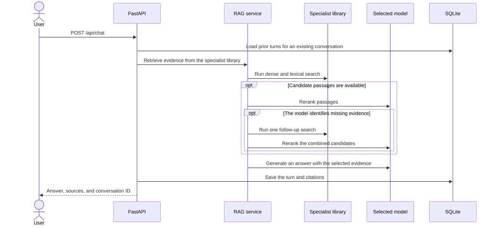

# Especialistas · RAG for personal libraries

Author: **Dangeles Lima**

[Leia em português](README.md)

A local-first app for asking questions about collections of PDFs and EPUBs. Each specialist has a separate library, instructions, and conversation history. Answers link citations to the retrieved passage and its PDF page or EPUB section.

The pipeline combines dense and lexical retrieval with multilingual E5 embeddings, local Qdrant, BM25, and Reciprocal Rank Fusion. An LLM reranks passages, can request one follow-up search for missing evidence, and generates an answer grounded in the selected passages. The vanilla JavaScript frontend talks to the Python backend over a FastAPI HTTP JSON interface.

## Run locally

Requirements: Python 3.12+, LM Studio with its REST v1 API, disk space for model weights, and Tesseract with `por` or `eng` language data for documents that need OCR.

```bash
python3.12 -m venv .venv
source .venv/bin/activate
python -m pip install -e '.[dev]'
cp .env.example .env
```

Download the embedding model once. Indexing uses the local weights on subsequent runs. [multilingual-e5-small model card](https://huggingface.co/intfloat/multilingual-e5-small)

```bash
python -m pip install huggingface_hub
hf download intfloat/multilingual-e5-small --local-dir data/models/multilingual-e5-small
```

1. Load a chat model and start the LM Studio server from the **Developer** tab. The first loaded instance is selected by default. [LM Studio REST API](https://lmstudio.ai/docs/developer/rest)
2. Run `especialistas-rag platform-serve` and open [the local app](http://127.0.0.1:8001).
3. Select or create a specialist, upload a PDF or EPUB, and wait for indexing. Use **Atualizar modelos** to refresh the model list after switching models in LM Studio. The API is documented in [Swagger](http://127.0.0.1:8001/docs).

## Model configuration

| Variable | Purpose |
| --- | --- |
| `TAC_LM_URL` | LM Studio URL. Defaults to `http://127.0.0.1:1234`. |
| `LMSTUDIO_API_TOKEN` | Token for an LM Studio server with authentication enabled. |
| `GOOGLE_API_KEY` | Optional Gemini key. `GEMINI_API_KEY` is also accepted. |
| `TAC_GOOGLE_MODEL` | ID of a Gemini model supported by the OpenAI-compatible chat endpoint. Set it alongside the key. |
| `TAC_DATA` | Directory for libraries, indexes, and conversations. Defaults to `data/`. |
| `TAC_EMBEDDING_MODEL` | Path to local E5 weights. Defaults to `<TAC_DATA>/models/multilingual-e5-small`. |

The backend reads credentials at startup. Selecting **Google Gemini** sends the question, recent conversation context, and passages used for reranking and answering to Google's API. Requests that omit a model use LM Studio exclusively. [Gemini API compatibility](https://ai.google.dev/gemini-api/docs/openai)

## Architecture



| Code | Responsibility |
| --- | --- |
| [`web/api.py`](src/especialistas_rag/web/api.py) | Validates requests, serves the UI, and tracks background ingestion. |
| [`rag.py`](src/especialistas_rag/rag.py) | Selects evidence, refines searches, and generates cited answers. |
| [`adapters/`](src/especialistas_rag/adapters) | Integrates PDF, EPUB, OCR, Qdrant, SQLite, and LLM providers. |
| [`retrieval.py`](src/especialistas_rag/retrieval.py) | Loads the E5 encoder and normalizes terms for lexical search. |
| [`settings.py`](src/especialistas_rag/settings.py) | Loads configuration and credentials on the backend. |
| [`evals/`](evals) | Generates a disposable corpus and measures retrieval, answers, and citations. |



## Evaluation

**Cedro v2** uses **30 Portuguese questions** over **24 passages in eight fictional documents**. There are six questions of each type: direct, paraphrased, confusable, requiring two passages, and unanswered by the corpus. The reference labels identify exact EPUB sections.

### Hybrid retrieval results

Local run with multilingual-e5-small, Qdrant, and BM25. The metrics below cover the **24 answerable questions** and measure retrieval before LLM reranking.

| Cutoff | At least one correct passage | All required passages |
| --- | ---: | ---: |
| Top 1 | 20/24 (83.3%) | 15/24 (62.5%) |
| Top 3 | 23/24 (95.8%) | 22/24 (91.7%) |
| Top 5 | 24/24 (100%) | 23/24 (95.8%) |

**MRR@5 was 0.897**. The top five contained both required passages for **5/6** two-passage questions. For the remaining question, which compared the rainfall thresholds in the pilot and current rules, retrieval surfaced only the current rule. These results measure regressions on a controlled corpus.

```bash
python -m pytest -q
python -m evals.run > /tmp/cedro-v2.json
```

The evaluator imports EPUBs into a temporary directory and returns per-question rankings, metrics by question type, and the SHA-256 of the embedding weights. With a model loaded in LM Studio, `python -m evals.run --generate` also compares answers with and without RAG, checks citations, and measures abstention on the six unanswerable questions. Its answer checker uses accepted text variants and can miss valid paraphrases.

## Local data

Git ignores `.env`, books, uploads, conversations, model weights, indexes, and generated results. A fresh checkout includes the code and evaluations that generate their own inputs. The `data/`, `source_books/`, `experiments/`, `build/`, and `output/` directories hold local data, including the original experiment corpus and outputs. Existing libraries and conversations keep their storage format.

Keep private drafts and notes in `local/docs/`, which Git also ignores.

The server is intended to run on `127.0.0.1`. Each specialist has an embedded Qdrant index, and ingestion runs in the background within the API process.
