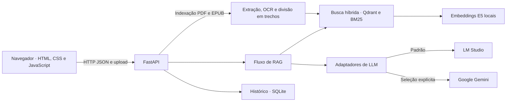
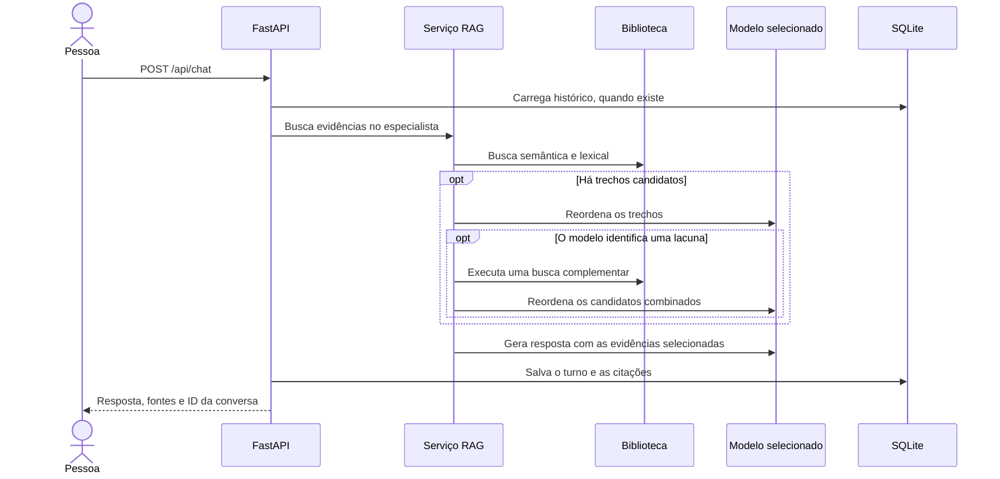

# Especialistas · RAG para bibliotecas pessoais

Autor: **Dangeles Lima**

[Read in English](README.en.md)

Um aplicativo local para fazer perguntas sobre coleções de PDF e EPUB. Cada especialista tem biblioteca, instruções e histórico próprios. As respostas exibem citações que abrem o trecho e a página do PDF ou a seção do EPUB.

O pipeline combina busca semântica e lexical, com embeddings multilíngues E5, Qdrant local, BM25 e Reciprocal Rank Fusion. Um LLM reordena os trechos, pode pedir uma segunda busca para preencher uma lacuna e gera a resposta com as evidências selecionadas. O frontend usa JavaScript nativo e conversa com o backend por HTTP JSON via FastAPI.

## Executar localmente

Requisitos: Python 3.12+, LM Studio com a API REST v1, espaço em disco para os pesos do modelo e Tesseract caso sejam necessários OCR e os idiomas `por` ou `eng`.

```bash
python3.12 -m venv .venv
source .venv/bin/activate
python -m pip install -e '.[dev]'
cp .env.example .env
```

Baixe o modelo de embeddings uma vez. A indexação usa os pesos locais nas execuções seguintes. [Modelo multilingual-e5-small](https://huggingface.co/intfloat/multilingual-e5-small)

```bash
python -m pip install huggingface_hub
hf download intfloat/multilingual-e5-small --local-dir data/models/multilingual-e5-small
```

1. Carregue um modelo de chat no LM Studio e inicie o servidor local na aba **Developer**. A primeira instância carregada é a seleção inicial. [API REST do LM Studio](https://lmstudio.ai/docs/developer/rest)
2. Execute `especialistas-rag platform-serve` e abra [a interface local](http://127.0.0.1:8001).
3. Selecione ou crie um especialista, importe um PDF ou EPUB e aguarde a indexação. Use **Atualizar modelos** ao trocar de modelo no LM Studio. A interface da API está no [Swagger](http://127.0.0.1:8001/docs).

## Configuração de modelos

| Variável | Uso |
| --- | --- |
| `TAC_LM_URL` | Endereço do LM Studio. O padrão é `http://127.0.0.1:1234`. |
| `LMSTUDIO_API_TOKEN` | Token quando a autenticação do LM Studio está ativada. |
| `GOOGLE_API_KEY` | Chave opcional do Gemini. `GEMINI_API_KEY` também é aceita. |
| `TAC_GOOGLE_MODEL` | ID de um modelo Gemini com suporte a chat compatível com OpenAI. Preencha junto com a chave. |
| `TAC_DATA` | Diretório para bibliotecas, índices e conversas. O padrão é `data/`. |
| `TAC_EMBEDDING_MODEL` | Caminho local dos pesos E5. O padrão é `<TAC_DATA>/models/multilingual-e5-small`. |

As credenciais são lidas pelo backend ao iniciar. Se você selecionar **Google Gemini** na interface, a API do Google recebe a pergunta, o contexto recente e os trechos utilizados na reordenação e na resposta. Uma chamada sem modelo explícito usa apenas o LM Studio. [Compatibilidade da API Gemini](https://ai.google.dev/gemini-api/docs/openai)

## Arquitetura



| Código | Responsabilidade |
| --- | --- |
| [`web/api.py`](src/especialistas_rag/web/api.py) | Valida requisições, serve a interface e acompanha a indexação em segundo plano. |
| [`rag.py`](src/especialistas_rag/rag.py) | Seleciona evidências, refina a busca e gera respostas com citações. |
| [`adapters/`](src/especialistas_rag/adapters) | Integra PDF, EPUB, OCR, Qdrant, SQLite e provedores de LLM. |
| [`retrieval.py`](src/especialistas_rag/retrieval.py) | Carrega o encoder E5 e normaliza os termos da busca lexical. |
| [`settings.py`](src/especialistas_rag/settings.py) | Lê a configuração e as credenciais no backend. |
| [`evals/`](evals) | Gera o corpus descartável e mede recuperação, respostas e citações. |



## Avaliação

```bash
python -m pytest -q
python -m evals.run
python -m evals.run --generate
```

O avaliador gera quatro documentos fictícios em um diretório temporário, passa pelo importador de EPUB e mede **Hit@1**, **Hit@3** e **MRR@3** em seis perguntas com fonte esperada. A opção `--generate` usa o LM Studio carregado para comparar respostas com e sem RAG. O JSON apresenta a taxa de correspondência com respostas esperadas e métricas de citações válidas e da obra esperada. São verificações de regressão sobre um corpus pequeno, com correspondência textual sujeita a paráfrases.

Em uma execução local com Gemma, a fonte esperada ficou em primeiro lugar nas seis perguntas (MRR@3 de 1,00). Com RAG, as seis respostas corresponderam ao gabarito e citaram a obra esperada. Sem RAG, nenhuma correspondeu ao gabarito.

## Dados locais

O Git ignora `.env`, livros, uploads, conversas, pesos, índices e resultados. A árvore começa apenas com o código e as avaliações que geram suas próprias entradas. Os diretórios `data/`, `source_books/`, `experiments/`, `build/` e `output/` contêm material local, incluindo o corpus e os artefatos do experimento original. O app preserva o formato das bibliotecas e conversas existentes.

Rascunhos e anotações locais ficam em `local/docs/`, que também é ignorado pelo Git.

O servidor é voltado ao uso em `127.0.0.1`. Ele mantém um índice Qdrant embutido por especialista e executa a indexação em segundo plano no processo da API.
